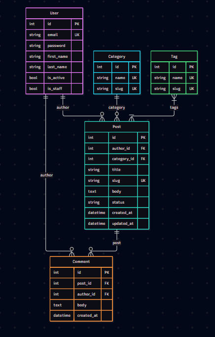

# Blog AI Django

REST API for blog on Django and DRF

## Structure for DataBases (ERD)



## HomeWork 2: Seeding & Unfold Admin

### Database Seeding Command

Fill all models with fake data:

```bash
python manage.py seed --users 50 --posts 300 --comments 1500